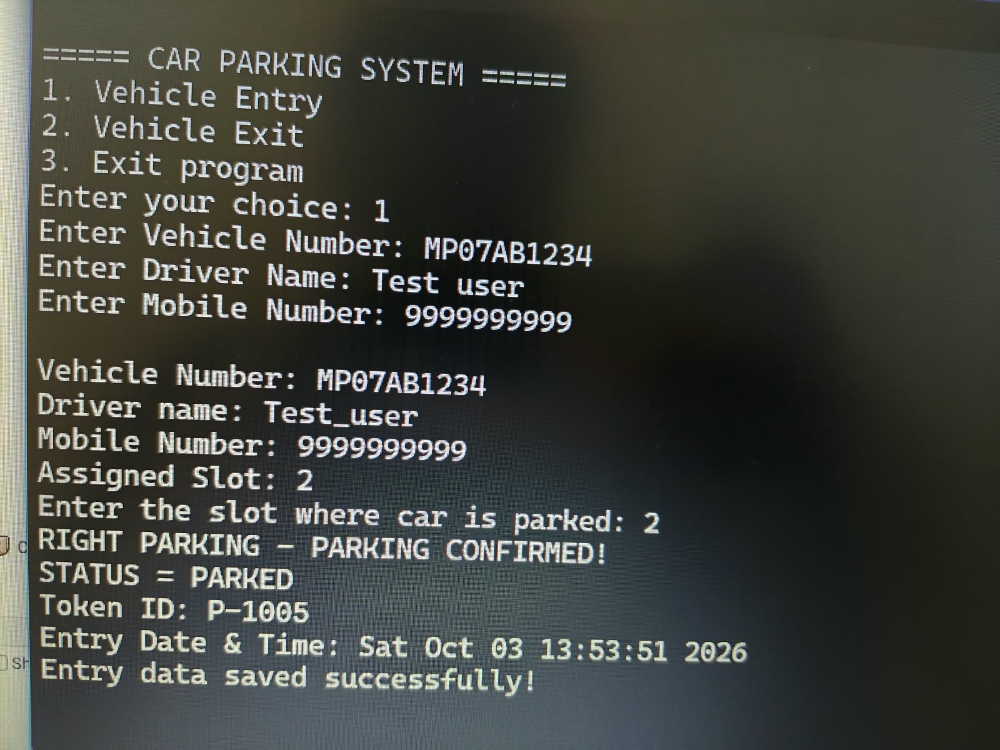
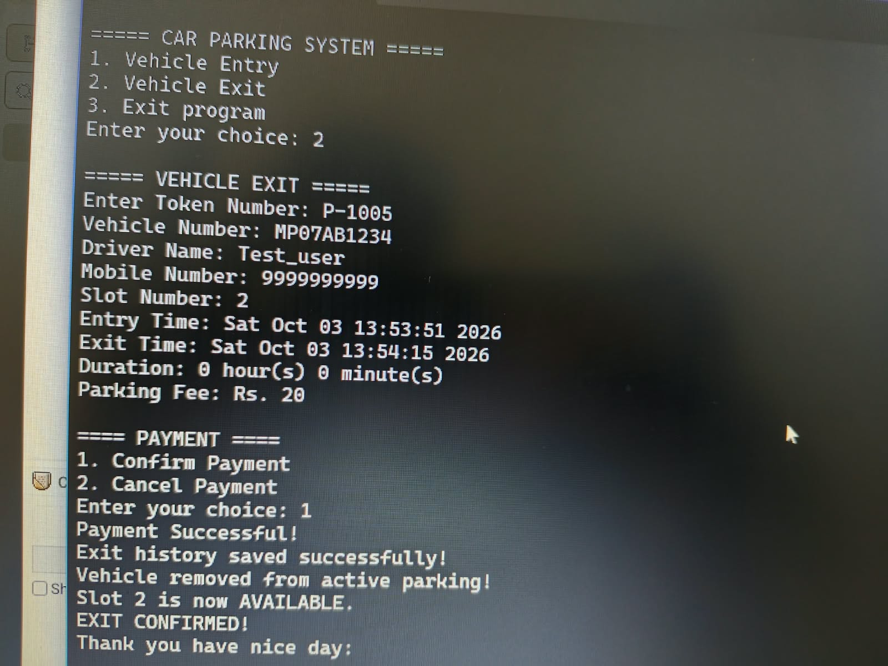

 # Car Parking Management

A console-based car parking management system written in C++ using file handling (`data.text` and `exit.text`).

## Features
- Vehicle entry with automatic free slot allocation (30 slots)
- Unique token ID (`P-1001`, etc.) and duplicate vehicle check
- Wrong-parking detection and option to change parking slot
- Vehicle exit with automatic duration & fee calculation (`Rs. 20` per hour) and payment confirmation
- 
## How to Run
1. Open `PARKING.cpp` in Dev-C++.
2. Press F11 (Compile & Run).

## Screenshots

   
